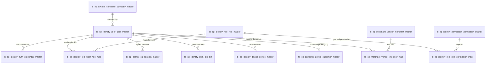
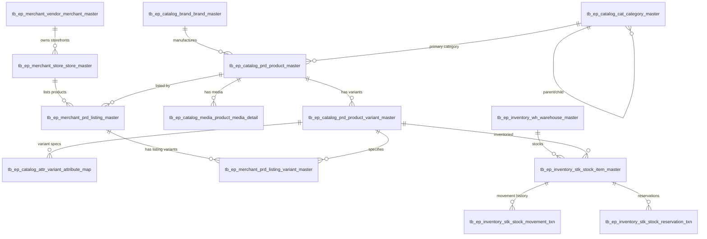
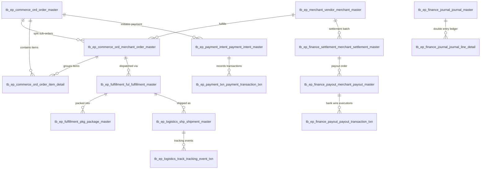

# Everest Pasal - Database Relationship Map & Foreign Key Architecture

## 1. Architectural Principles

1. **Immutable UUID Primary Keys**: Every table has `id uuid PRIMARY KEY DEFAULT gen_random_uuid()`.
2. **Mandatory Company Multi-Tenancy**: Every foreign key constraint operates within the boundary of a single `company_code`.
3. **Restrictive Referential Actions (`ON DELETE RESTRICT`)**: By policy, financial, transactional, inventory movement, and audit records MUST use `ON DELETE RESTRICT` (or `NO ACTION`) to preserve historical integrity. Cascade deletion is strictly forbidden on transactional data.
4. **Decoupled Snapshots for Historical Audit**: Commerce, fulfillment, and finance tables do not dynamically join against mutable master data (e.g. current product price or name); they persist locked snapshots (`product_name_snapshot`, `sku_snapshot`, `unit_price`, `order_address_snapshot`).

---

## 2. Core Domain Relationship Trees

### 2.1 Identity, Authentication & Multi-Surface Access Control

### 2.2 Product Catalog, Listing & Inventory Lifecycle

### 2.3 Order, Payment, Fulfillment & Merchant Settlement Lifecycle

---

## 3. Detailed Cross-Schema Foreign Key Reference Matrix

| # | Child Schema & Table Name | Foreign Key Column | Target (Parent) Schema & Table | Target PK |
|---|---|---|---|---|
| 1 | `ep_system.tb_ep_system_company_company_address_detail` | `country_code` | `ep_geo.tb_ep_geo_country_country_master` | `country_code` |
| 2 | `ep_system.tb_ep_system_company_company_address_detail` | `city_code` | `ep_geo.tb_ep_geo_city_city_master` | `city_code` |
| 3 | `ep_system.tb_ep_system_company_database_route_setup` | `database_link_code` | `ep_system.tb_ep_system_company_database_link_setup` | `database_link_code` |
| 4 | `ep_geo.tb_ep_geo_province_province_master` | `country_code` | `ep_geo.tb_ep_geo_country_country_master` | `country_code` |
| 5 | `ep_geo.tb_ep_geo_district_district_master` | `province_code` | `ep_geo.tb_ep_geo_province_province_master` | `province_code` |
| 6 | `ep_geo.tb_ep_geo_city_city_master` | `country_code` | `ep_geo.tb_ep_geo_country_country_master` | `country_code` |
| 7 | `ep_geo.tb_ep_geo_city_city_master` | `province_code` | `ep_geo.tb_ep_geo_province_province_master` | `province_code` |
| 8 | `ep_geo.tb_ep_geo_city_city_master` | `district_code` | `ep_geo.tb_ep_geo_district_district_master` | `district_code` |
| 9 | `ep_identity.tb_ep_identity_auth_credential_master` | `user_id` | `ep_identity.tb_ep_identity_user_user_master` | `id` |
| 10 | `ep_identity.tb_ep_identity_role_user_role_map` | `user_id` | `ep_identity.tb_ep_identity_user_user_master` | `id` |
| 11 | `ep_identity.tb_ep_identity_role_user_role_map` | `role_id` | `ep_identity.tb_ep_identity_role_role_master` | `id` |
| 12 | `ep_identity.tb_ep_identity_role_role_permission_map` | `role_id` | `ep_identity.tb_ep_identity_role_role_master` | `id` |
| 13 | `ep_identity.tb_ep_identity_role_role_permission_map` | `permission_id` | `ep_identity.tb_ep_identity_permission_permission_master` | `id` |
| 14 | `ep_customer.tb_ep_customer_profile_customer_master` | `user_id` | `ep_identity.tb_ep_identity_user_user_master` | `id` |
| 15 | `ep_customer.tb_ep_customer_address_address_detail` | `customer_id` | `ep_customer.tb_ep_customer_profile_customer_master` | `id` |
| 16 | `ep_merchant.tb_ep_merchant_vendor_member_map` | `merchant_id` | `ep_merchant.tb_ep_merchant_vendor_merchant_master` | `id` |
| 17 | `ep_merchant.tb_ep_merchant_vendor_member_map` | `user_id` | `ep_identity.tb_ep_identity_user_user_master` | `id` |
| 18 | `ep_merchant.tb_ep_merchant_store_store_master` | `merchant_id` | `ep_merchant.tb_ep_merchant_vendor_merchant_master` | `id` |
| 19 | `ep_merchant.tb_ep_merchant_prd_listing_master` | `merchant_id` | `ep_merchant.tb_ep_merchant_vendor_merchant_master` | `id` |
| 20 | `ep_merchant.tb_ep_merchant_prd_listing_master` | `store_id` | `ep_merchant.tb_ep_merchant_store_store_master` | `id` |
| 21 | `ep_merchant.tb_ep_merchant_prd_listing_master` | `product_id` | `ep_catalog.tb_ep_catalog_prd_product_master` | `id` |
| 22 | `ep_merchant.tb_ep_merchant_prd_listing_variant_master` | `listing_id` | `ep_merchant.tb_ep_merchant_prd_listing_master` | `id` |
| 23 | `ep_merchant.tb_ep_merchant_prd_listing_variant_master` | `variant_id` | `ep_catalog.tb_ep_catalog_prd_product_variant_master` | `id` |
| 24 | `ep_catalog.tb_ep_catalog_prd_product_master` | `brand_id` | `ep_catalog.tb_ep_catalog_brand_brand_master` | `id` |
| 25 | `ep_catalog.tb_ep_catalog_prd_product_master` | `category_id` | `ep_catalog.tb_ep_catalog_cat_category_master` | `id` |
| 26 | `ep_catalog.tb_ep_catalog_prd_product_variant_master` | `product_id` | `ep_catalog.tb_ep_catalog_prd_product_master` | `id` |
| 27 | `ep_inventory.tb_ep_inventory_stk_stock_item_master` | `warehouse_id` | `ep_inventory.tb_ep_inventory_wh_warehouse_master` | `id` |
| 28 | `ep_inventory.tb_ep_inventory_stk_stock_item_master` | `variant_id` | `ep_catalog.tb_ep_catalog_prd_product_variant_master` | `id` |
| 29 | `ep_inventory.tb_ep_inventory_stk_stock_movement_txn` | `stock_item_id` | `ep_inventory.tb_ep_inventory_stk_stock_item_master` | `id` |
| 30 | `ep_commerce.tb_ep_commerce_ord_order_master` | `customer_id` | `ep_customer.tb_ep_customer_profile_customer_master` | `id` |
| 31 | `ep_commerce.tb_ep_commerce_ord_merchant_order_master` | `order_id` | `ep_commerce.tb_ep_commerce_ord_order_master` | `id` |
| 32 | `ep_commerce.tb_ep_commerce_ord_merchant_order_master` | `merchant_id` | `ep_merchant.tb_ep_merchant_vendor_merchant_master` | `id` |
| 33 | `ep_commerce.tb_ep_commerce_ord_order_item_detail` | `order_id` | `ep_commerce.tb_ep_commerce_ord_order_master` | `id` |
| 34 | `ep_commerce.tb_ep_commerce_ord_order_item_detail` | `merchant_order_id` | `ep_commerce.tb_ep_commerce_ord_merchant_order_master` | `id` |
| 35 | `ep_payment.tb_ep_payment_intent_payment_intent_master` | `order_id` | `ep_commerce.tb_ep_commerce_ord_order_master` | `id` |
| 36 | `ep_payment.tb_ep_payment_txn_payment_transaction_txn` | `payment_intent_id` | `ep_payment.tb_ep_payment_intent_payment_intent_master` | `id` |
| 37 | `ep_finance.tb_ep_finance_settlement_merchant_settlement_master` | `merchant_id` | `ep_merchant.tb_ep_merchant_vendor_merchant_master` | `id` |
| 38 | `ep_finance.tb_ep_finance_payout_merchant_payout_master` | `settlement_id` | `ep_finance.tb_ep_finance_settlement_merchant_settlement_master` | `id` |
| 39 | `ep_fulfillment.tb_ep_fulfillment_ful_fulfillment_master` | `merchant_order_id` | `ep_commerce.tb_ep_commerce_ord_merchant_order_master` | `id` |
| 40 | `ep_logistics.tb_ep_logistics_shp_shipment_master` | `fulfillment_id` | `ep_fulfillment.tb_ep_fulfillment_ful_fulfillment_master` | `id` |
| 41 | `ep_returns.tb_ep_returns_req_return_request_master` | `order_id` | `ep_commerce.tb_ep_commerce_ord_order_master` | `id` |
| 42 | `ep_kyc.tb_ep_kyc_case_verification_case_master` | `subject_id` | `ep_kyc.tb_ep_kyc_subject_subject_master` | `id` |
| 43 | `ep_kyc.tb_ep_kyc_document_document_master` | `case_id` | `ep_kyc.tb_ep_kyc_case_verification_case_master` | `id` |
| 44 | `ep_kyc.tb_ep_kyc_check_verification_check_txn` | `case_id` | `ep_kyc.tb_ep_kyc_case_verification_case_master` | `id` |
| 45 | `ep_kyc.tb_ep_kyc_risk_risk_flag_txn` | `case_id` | `ep_kyc.tb_ep_kyc_case_verification_case_master` | `id` |
| 46 | `ep_kyc.tb_ep_kyc_decision_decision_history` | `case_id` | `ep_kyc.tb_ep_kyc_case_verification_case_master` | `id` |
