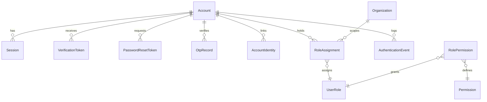
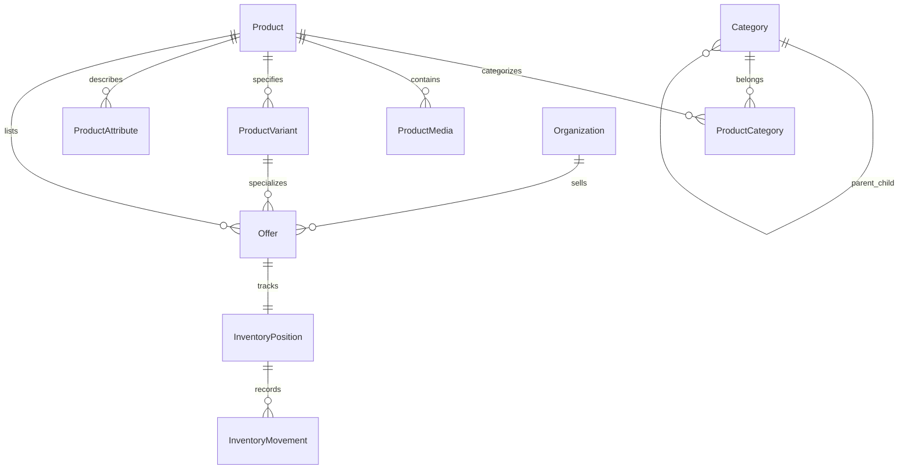
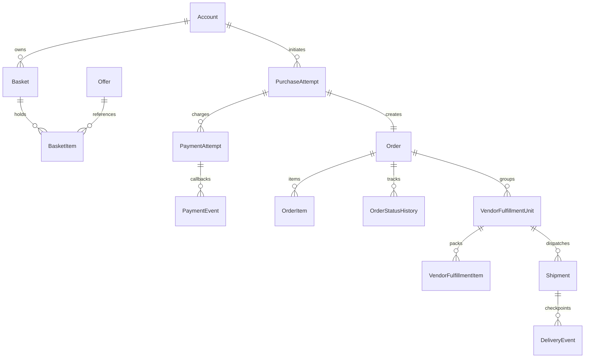
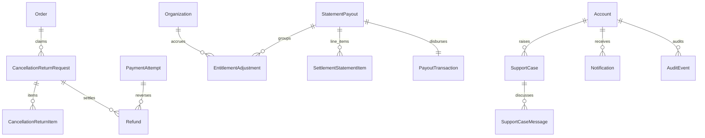

# EVEREST PASAL — COMPLETE DATABASE ARCHITECTURE ROADMAP
## Production Database Blueprint & CRUD Resource Matrix

---

## 1. PLATFORM ARCHITECTURAL TOTALS & ENTITY COUNTS

Calculated directly from the current production schema and complete future design:

- **Total Physical Tables (Current Phase 1)**: **46**
- **Core Domain Entities**: 26
- **Authentication & RBAC Tables**: 9 (`Account`, `Session`, `VerificationToken`, `PasswordResetToken`, `OtpRecord`, `AccountIdentity`, `Permission`, `RolePermission`, `RoleAssignment`)
- **Product Catalog Tables**: 7 (`Category`, `ProductCategory`, `Product`, `ProductMedia`, `ProductAttribute`, `ProductVariant`, `Offer`)
- **Inventory & Ledger Tables**: 2 (`InventoryPosition`, `InventoryMovement`)
- **Customer & Basket Tables**: 4 (`Basket`, `BasketItem`, `Address`, `DelegationConsent`)
- **Checkout & Order Tables**: 4 (`PurchaseAttempt`, `Order`, `OrderItem`, `OrderStatusHistory`)
- **Payment Tables**: 2 (`PaymentAttempt`, `PaymentEvent`)
- **Fulfillment Tables**: 4 (`VendorFulfillmentUnit`, `VendorFulfillmentItem`, `Shipment`, `DeliveryEvent`)
- **Returns & Refunds Tables**: 3 (`CancellationReturnRequest`, `CancellationReturnItem`, `Refund`)
- **Campaign & Marketing Tables**: 2 (`Campaign`, `CampaignAttribution`)
- **Settlement & Finance Tables**: 4 (`EntitlementAdjustment`, `StatementPayout`, `SettlementStatementItem`, `PayoutTransaction`)
- **Customer Support Tables**: 2 (`SupportCase`, `SupportCaseMessage`)
- **Governance & Audit Tables**: 3 (`Notification`, `AuditEvent`, `ConfigurationVersion`)
- **Total PostgreSQL Enums**: **26**
- **Total Database Indexes**: **92+**
- **Foreign Key Constraints**: **60+**
- **Unique Constraints**: **32+**

---

## 2. FULL CRUD → PHYSICAL DATABASE MATRIX

| CRUD Resource | Dashboard | Domain | Physical Table(s) | Core/Support | Owner / Scope | Main FK | Create | Read | Update | Lifecycle / Delete |
|---|---|---|---|---|---|---|---|---|---|---|
| **Profile** | Customer Web, Mobile | Identity | `Account` | Core | Account | `id` | Register | Owner / Admin | Owner | Deactivate (Soft) |
| **Address** | Customer Web | Customer | `Address` | Supporting | Account | `accountId` | Owner | Owner | Owner | Cascade Delete |
| **Wishlist** | Customer Web | Customer | `Wishlist`, `WishlistItem` | Supporting | Account | `accountId` | Owner | Owner | Owner | Delete Item |
| **Saved Payment** | Customer Web | Customer | `SavedPaymentMethod` | Supporting | Account | `accountId` | Owner | Owner | Owner | Revoke / Delete |
| **Support Ticket** | Customer Web | Support | `SupportCase`, `SupportCaseMessage` | Supporting | Account | `accountId` | Customer/Vendor | Involved/Agent | Agent/Customer | Close / Resolve |
| **Review** | Customer Web | Catalog | `ProductReview` | Supporting | Account | `accountId, productId` | Customer | Public | Customer | Flag / Hide |
| **Return** | Customer Web | Returns | `CancellationReturnRequest` | Core | Order | `orderId, requestedById` | Customer | Customer/Vendor/Admin | Admin/Vendor | Approve / Reject |
| **Notification Pref** | Customer Web | Config | `NotificationPreference` | Supporting | Account | `accountId` | Auto | Owner | Owner | Update |
| **Product** | Vendor, Admin | Catalog | `Product`, `ProductMedia` | Core | Platform | `brandId, categoryId` | Admin/Vendor | Public | Admin/Vendor | Archive / Discontinue |
| **Variant** | Vendor, Admin | Catalog | `ProductVariant` | Supporting | Product | `productId` | Admin/Vendor | Public | Admin/Vendor | Archive |
| **Seller Offer** | Vendor | Catalog | `Offer` | Core | Vendor | `organizationId, productId` | Vendor | Public | Vendor | Deactivate |
| **Inventory Item** | Vendor | Inventory | `InventoryPosition` | Core | Offer | `offerId` | System | Vendor/Admin | Movement | Freeze |
| **Stock Movement** | Vendor | Inventory | `InventoryMovement` | Supporting | Inventory | `positionId` | System/Vendor | Vendor/Admin | Immutable | Immutable (Append-only) |
| **Stock Location** | Vendor | Inventory | `StockLocation` | Config | Vendor | `organizationId` | Vendor | Vendor/Admin | Vendor | Deactivate |
| **Stock Transfer** | Vendor | Inventory | `StockTransfer`, `StockTransferItem` | Supporting | Vendor | `fromLocationId, toLocationId` | Vendor | Vendor/Admin | Vendor | Complete / Cancel |
| **Damaged Stock** | Vendor | Inventory | `InventoryMovement` (`WRITE_OFF`) | Supporting | Inventory | `positionId` | Vendor | Vendor/Admin | Immutable | Immutable |
| **Promotion / Coupon**| Vendor, Admin | Campaign | `Campaign` | Core | Platform/Vendor | `organizationId` | Vendor/Admin | Public | Vendor/Admin | Deactivate / Expire |
| **Store Policy** | Vendor | Vendor | `StorePolicy` | Config | Vendor | `organizationId` | Vendor | Public | Vendor | Update |
| **Pickup Location** | Vendor | Vendor | `PickupLocation` | Config | Vendor | `organizationId` | Vendor | Vendor/Admin | Vendor | Deactivate |
| **Staff User** | Vendor | Identity | `Account`, `RoleAssignment` | Supporting | Organization | `accountId, organizationId` | Vendor Admin | Vendor Admin | Vendor Admin | Revoke Role |
| **Role & Perms** | Vendor, Admin | RBAC | `UserRole`, `Permission`, `RolePermission` | Config | Platform | `role, permissionId` | Platform Admin | All | Platform Admin | Deactivate |
| **Bank Account** | Vendor, Agent | Finance | `BankAccount`, `PayoutAccount` | Supporting | Account/Org | `organizationId, accountId` | Owner | Owner/Finance | Owner | Archive |
| **Referral Link** | Agent, Influencer | Campaign | `ReferralLink` | Supporting | Account | `accountId, campaignId` | Agent/Influencer | Public | Agent/Influencer | Deactivate |
| **QR Campaign** | Agent | Campaign | `QRCampaign` | Supporting | Account | `accountId, campaignId` | Agent | Public | Agent | Expire |
| **Saved Cart** | Agent, Customer | Basket | `Basket`, `BasketItem` | Supporting | Account | `accountId` | Customer/Agent | Owner | Owner | Checkout / Expire |
| **Influencer App** | Influencer | Identity | `InfluencerApplication` | Supporting | Account | `accountId` | Influencer | Admin/Influencer | Admin | Approve / Reject |
| **Category** | Admin | Catalog | `Category`, `ProductCategory` | Core | Platform | `parentId` | Admin | Public | Admin | Deactivate |
| **Brand** | Admin | Catalog | `Brand` | Core | Platform | `id` | Admin | Public | Admin | Archive |
| **Attribute** | Admin | Catalog | `Attribute`, `AttributeValue` | Core | Platform | `productId` | Admin | Public | Admin | Archive |
| **Vendor KYC Doc** | Admin | Vendor | `VendorKYCDocument` | Supporting | Organization | `organizationId` | Vendor | Admin/Vendor | Admin | Verify / Reject |
| **Commission Rule** | Admin | Finance | `CommissionRule` | Config | Platform | `categoryId, organizationId` | Admin | Finance/Vendor | Admin | Supersede |
| **Shipping Zone** | Admin | Logistics | `ShippingZone`, `DeliveryService` | Config | Platform | `countryCode` | Admin | Public | Admin | Deactivate |
| **Payment Provider** | Admin | Payment | `PaymentProvider`, `PaymentMethodConfig`| Config | Platform | `providerCode` | Admin | Internal | Admin | Deactivate |
| **Settlement Rule** | Admin | Finance | `SettlementRule`, `StatementPayout` | Core | Platform | `organizationId` | Admin/System | Finance/Vendor | Finance | Disburse / Close |
| **Tax Rule** | Admin | Finance | `TaxRule`, `HSCode` | Config | Platform | `countryCode` | Admin | Public | Admin | Update |
| **Support SLA** | Admin | Support | `SupportCategory`, `SupportSLA` | Config | Platform | `categoryId` | Admin | Public | Admin | Update |
| **Feature Flag** | Admin | Config | `ConfigurationVersion` | Config | Platform | `key, environment` | Admin | System | Admin | Version / Rollback |
| **Audit Export** | Admin | Audit | `AuditEvent`, `AuthenticationEvent` | History | Platform | `actorId, accountId` | System | Admin | Immutable | Retain (7-30 days) |

---

## 3. MULTI-PHASE IMPLEMENTATION BLUEPRINT

```
PHASE 1: Authentication, Identity & Access Control (COMPLETED)
  ├── Account, Session, VerificationToken, PasswordResetToken, OtpRecord
  └── AccountIdentity, Permission, RolePermission, RoleAssignment, AuthenticationEvent

PHASE 2: Customer Identity & Commerce Experience
  ├── CustomerProfile, Address, Wishlist, WishlistItem, SavedPaymentMethod
  └── ProductReview, NotificationPreference, SupportCase, SupportCaseMessage

PHASE 3: Product Catalog & Taxonomy Architecture
  ├── Category, ProductCategory, Brand, Attribute, AttributeValue
  └── Product, ProductMedia, ProductVariant, Offer, ProductDocument

PHASE 4: Inventory Management & Ledger
  ├── InventoryPosition, InventoryMovement, StockLocation, StockTransfer
  └── StockTransferItem, PickupLocation, StorePolicy

PHASE 5: Checkout, Orders & Payments
  ├── Basket, BasketItem, PurchaseAttempt, Order, OrderItem
  └── OrderStatusHistory, PaymentAttempt, PaymentEvent

PHASE 6: Logistics, Fulfillment & Reverse Commerce
  ├── VendorFulfillmentUnit, VendorFulfillmentItem, Shipment, DeliveryEvent
  └── CancellationReturnRequest, CancellationReturnItem, Refund

PHASE 7: Marketing, Affiliate & Influencer Center
  ├── Campaign, CampaignAttribution, ReferralLink, QRCampaign
  └── InfluencerProfile, InfluencerApplication, AgentProfile, PromoCode

PHASE 8: Financial Clearing, Settlement & Admin Governance
  ├── EntitlementAdjustment, StatementPayout, SettlementStatementItem, PayoutTransaction
  ├── CommissionRule, TaxRule, HSCode, ShippingZone, DeliveryService
  └── ConfigurationVersion, AuditEvent, NotificationTemplate, WebhookEndpoint
```

---

## 4. DOMAIN ENTITY RELATIONSHIP DIAGRAMS

### 01. Authentication & RBAC Domain


### 02. Catalog & Inventory Domain


### 03. Orders, Payments & Fulfillment Domain


### 04. Returns, Settlements & Governance Domain

